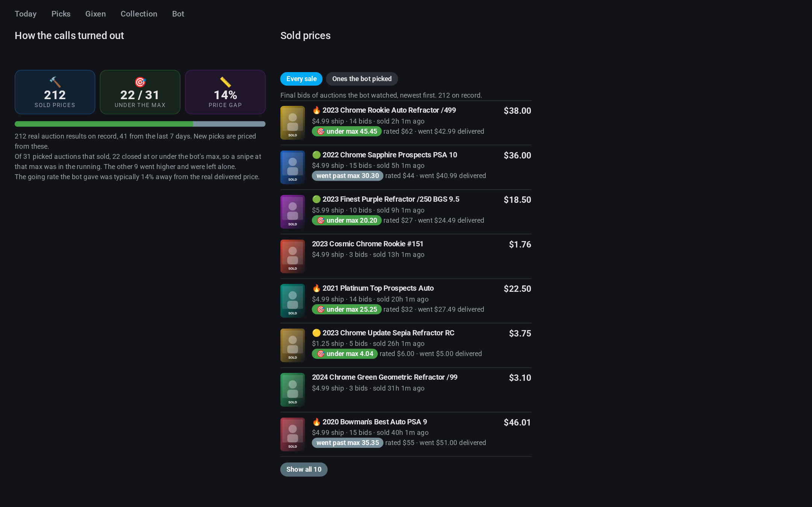

<p align="center"></p>

# Snipe Hunt for Home Assistant

[](https://hacs.xyz)
[](https://github.com/jordanwalk193/ha-snipe-hunt/actions/workflows/validate.yml)
[](LICENSE)

A Home Assistant integration for [**Snipe Hunt**](https://github.com/jordanwalk193/snipe-hunt), a self-hosted bot that hunts eBay for underpriced cards of the player you collect. The bot runs on its own machine; this integration shows what it knows, lets you steer it, and ships the dashboard.

Snipe Hunt only recommends. Nothing in this integration can bid, buy, make an offer or change a Gixen snipe, because the bot has no way to do any of those.


<p>



</p>

<sub>Screenshots show the bot's built-in demo data. Every card, price and seller in them is made up.</sub>

## What you get

- **Entities** on one "Snipe Hunt" device: live picks, what needs a snipe, the top pick, Gixen snipes and the next one to end, win rate, collection size and spend, budget left, what's waiting to be paid or filed, and bot health.
- **Settings as entities**: whichever settings the bot exposes show up as switches, numbers, times and text boxes (monthly budget, the "needs a snipe" window, which tiers alert, the minimum deal rating worth an alert, the most a guessed-price Buy It Now may cost and still alert, how much eBay feedback a seller needs before a dear pick is trusted, quiet hours, the bedtime bundle, self-tuning, watched sellers, extra searches, sellers who combine shipping). A setting the bot doesn't expose shows as unavailable instead of pretending to work.
- **Buttons and services**: search now, refresh, re-read Gixen, sign in to Gixen, restore skipped picks, send a test alert, skip a pick, mark cards filed, and give feedback on a pick (👎 Bad pick with a reason and note, which hides it; 👍 Good call, which keeps it) so the bot's scoring learns what you like.
- **Deal ratings and running cost**: every pick shows one to five stars for how far under the going rate you would pay, and two sensors track what Claude has cost today and this month.
- **The bot's doubts, shown**: a dear Buy It Now priced from a guess is flagged "⚠️ Unverified price" (and is never the top pick), a pick over $30 from a seller with little feedback is flagged "⚠️ New seller", every pick names its seller's feedback, and a max with no sales behind it reads "(guess, no sales found)".
- **Slipped-through labels**: picks the bot calls a price mistake, a hidden listing or a sleeper auction carry a badge, rank first among equal deals, and have their own filter on the Steals tab.
- **Two bids on every auction**: the bot's cheapskate max and a "to win" bid at about the going rate, each with its own copy button, plus "same card last sold for" from the bot's own record.
- **A read on your Gixen amounts**: each scheduled snipe is marked over the going rate, fair, a real discount or a long shot, with what the card goes for and the bid it would take to win.
- **Scorecard sensors**: how many sold prices the bot has on record, and what share of its picks went on to sell at or under its max, ready for a graph or an automation.
- **A dashboard**: one card type with thirty-four panels (including a Top 10 deals ranking, the best steals under $20, rookie steals, the top steals for each card year, the ten rarest cards for sale right now, real sold prices and a scorecard of how the bot's picks turned out), and a dashboard strategy that lays them out in four tabs: **Tonight** (a single to-do list of snipes to set, lowball snipes, Gixen snipes to check, sellers to pay and offers to send, soonest first), **Steals** (one list with a chip per cut: best, under $20, rookies, by year, rarest, lowball, offers, price drops, missed steals, every pick), **Collection** (incoming cards, must-haves and rainbows, every card, the want list) and **Stats & bot**. Every auction shows how far its bid has climbed toward the bot's max (🔥 Heating up past 80%) and how old that price is, Tonight opens with a warning when a Gixen snipe looks wrong, and a 🚨 JACKPOT (a $20+ card for a sliver of its value, from the bot's jackpot alerts) gets a pulsing banner with a Buy now button at the top of Tonight and Steals. Under it, **⏱️ Bid now, think later** lists auctions ending within the hour at 90% or more off their value (the bot's `bid_now` list), each with its max to copy into Gixen. No other custom cards are needed.
- **An auctions calendar**: when each Gixen snipe ends, and good auctions that still have no snipe.
- **Automation hooks**: a "New pick" event entity (and the raw `snipe_hunt_new_pick` event), plus an "Unsniped auction ending soon" sensor that turns on when a good auction with no snipe is about to end.

## Install

1. In HACS, open the menu, choose **Custom repositories**, add `https://github.com/jordanwalk193/ha-snipe-hunt` as an **Integration**, then download **Snipe Hunt**.
2. Restart Home Assistant.
3. Go to **Settings → Devices & services → Add integration → Snipe Hunt**. No bot yet? Start one in [demo mode](https://github.com/jordanwalk193/snipe-hunt#try-it-in-two-minutes) to look around first.

   Then, with a real bot: Enter the bot's address (for example `http://192.0.2.10:8766`) and the `API_TOKEN` from the bot's env file.

## Dashboard

Create a dashboard (**Settings → Dashboards → Add dashboard → New dashboard from scratch**), open it, choose **Edit → Raw configuration editor**, and replace everything with:

```yaml
strategy:
  type: custom:snipe-hunt
```

The tabs, their order, the accent colour and how many picks show before "Show all" are set under **Settings → Devices & services → Snipe Hunt → Configure**. To override the tabs for one dashboard:

```yaml
strategy:
  type: custom:snipe-hunt
  title: Cards
  tabs: [tonight, steals, collection]
```

### Building your own layout

Any panel can go on any dashboard:

```yaml
type: custom:snipe-hunt-card
panel: need_snipe
title: Snipe these      # optional
accent: "#c41e3a"       # optional
```

| Panel | Shows |
|---|---|
| `summary` | The four numbers that matter today, plus Search and Refresh |
| `top_deals` | The ten best steals, ranked: most deal stars, then brag tier, then dollars under the going rate (`count:` changes the ten) |
| `under` | The best steals you can land for $20 or less delivered: Buy It Now price or the bot's max, plus shipping (`under:` changes the $20, `count:` the ten) |
| `focus` | Rookie steals: the player's rookie-year cards, plus any other group the bot marks (for Jordan Walker, 2019 Perfect Game), with a chip for each group (`count:` changes the ten) |
| `by_year` | The top steals for one card year at a time, with a chip for each year (`count:` changes the five) |
| `must_have` | The nine must-have cards of each year, with a button per year: which you own, how many are for sale now and the cheapest, and any live pick among them (needs the bot's `musthave.md`) |
| `offers` | Buy It Nows up a month or more with Best Offer on, with a suggested offer (about 70% of the price, under the going rate), on cards you don't own |
| `lowball` | Auctions of $15+ cards ending within two days, still under half their going rate, each with a low snipe to set in Gixen; marks dead-hour endings and listings buyers skip, and shows how ending time affects price |
| `todo` | Everything that wants a tap, soonest first: picks with no snipe, lowball snipes, Gixen snipes to check, auctions bid past your snipe but still cheap, sellers to pay now, offers to send, cards to file |
| `steals` | One list with a chip for each cut: best, under $20, rookies, by year, rarest, lowball, offers, price drops, every pick |
| `incoming` | On the way and delivered-to-file together |
| `missing` | Must-have cards and rainbows, one chip each |
| `rainbows` | Every parallel of the cards you chase, with a button per card: owned, for sale now, live picks (needs the bot's `rainbow.md`) |
| `rarest` | The ten lowest print runs for sale right now (1/1s, then /5, /10…), read from the listing titles (`count:` changes the ten) |
| `moves` | Sellers who blinked: Buy It Nows cut by 15% or more and unsold cards that came back (`count:` changes how many) |
| `history` | Cards that have sold more than once, with a small price trend |
| `calls` | Scorecard: sold prices on record, how many picked auctions closed at or under the bot's max, and how far its going rate was from the real price |
| `sold` | Final bids of the auctions the bot watched, newest first, with the bot's call on the ones it picked |
| `top_pick` | The best steal you haven't sniped yet (never a one-star pick) |
| `need_snipe` | Good auctions ending soon with no snipe |
| `snipes_today` | Your Gixen snipes ending in the next 24 hours |
| `pay` | Wins waiting on payment, grouped by seller |
| `all_picks` | Every live pick, with filters and sorting |
| `wantlist` | Chase targets and price ceilings |
| `gixen` | Every scheduled snipe |
| `gixen_gap` | Good auctions with no snipe (same list as `need_snipe`, no intro) |
| `record` | Win rate and the ones that got away |
| `collection` | Collection stats and this month's spend against the budget |
| `to_file` | Delivered cards to put in the binder, with Filed buttons |
| `on_the_way` | Cards in the mail and wins not yet shipped |
| `binder` | A searchable list of every card |
| `health` | Bot health and its buttons |

## Options

**Configure** on the integration sets how often Home Assistant checks the bot (30 seconds by default), the dashboard tabs, picks per page, the accent colour, which tiers fire the new-pick event, how many minutes count as "ending soon", and an optional web address for the weekly reports folder.

## Automations

```yaml
triggers:
  - trigger: event
    event_type: snipe_hunt_new_pick
    event_data:
      tier: fire
actions:
  - action: light.turn_on
    target:
      entity_id: light.office_lamp
    data:
      color_name: red
```

Or get told when a good auction is about to end with no snipe on it:

```yaml
triggers:
  - trigger: state
    entity_id: binary_sensor.snipe_hunt_unsniped_auction_ending_soon
    to: "on"
actions:
  - action: notify.mobile_app_your_phone
    data:
      title: No snipe yet
      message: "{{ state_attr(trigger.entity_id, 'card') }} ends soon. Max {{ state_attr(trigger.entity_id, 'max') }}"
      data:
        url: "{{ state_attr(trigger.entity_id, 'url') }}"
```

The event carries the pick: `item_id`, `card`, `tier`, `price`, `shipping`, `total`, `max`, `max_basis`, `value`, `deal` (1 to 5 stars), `deal_pct`, `is_auction`, `end_time`, `seller`, `why`, `url`, `image`.

Services: `snipe_hunt.search_now`, `refresh`, `skip_pick` (`item_id`), `pick_feedback` (`item_id`, `reason`: overvalued, wrong_card, bad_seller, dont_want_this_type, already_have, other or good_pick, optional `note` up to 200 characters), `restore_skipped`, `mark_filed` (`ids`), `gixen_refresh` (`login`), `send_test_alert`.

## The bot's API

[Snipe Hunt](https://github.com/jordanwalk193/snipe-hunt) serves this out of the box. The integration expects the bot to serve, behind a bearer token:

- `GET /api/snapshot`: one JSON object with `api: 1`, `status`, `picks`, `gixen`, `cards`, `collection`, `pipeline`, `record`, `wantlist`, `settings` and `last_action`.
- `POST /api/action`: `{"action": "...", ...}`; answers `{"ok", "message", "snapshot"}`.
- `POST /api/settings`: `{"setting": value, ...}`; same answer.

## License

MIT. See `LICENSE`.

## Development

```
pip install pytest-homeassistant-custom-component
pytest
```

## Support

This integration is free. If it finds you a steal and you'd like to say thanks:

[](https://paypal.me/jordanwalker1531)
